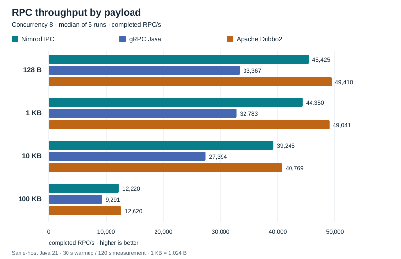
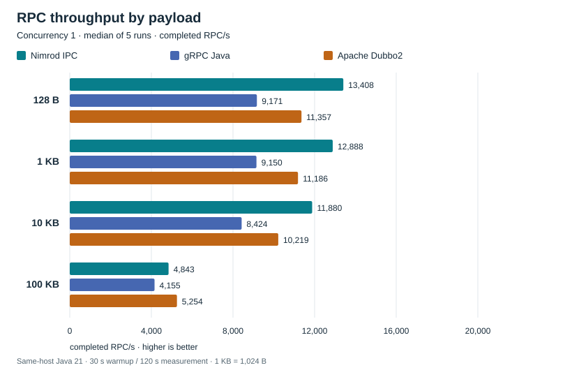
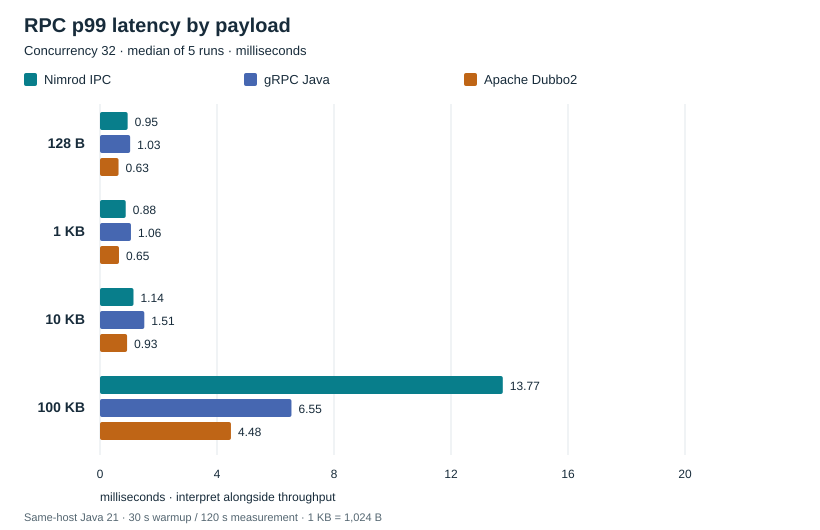
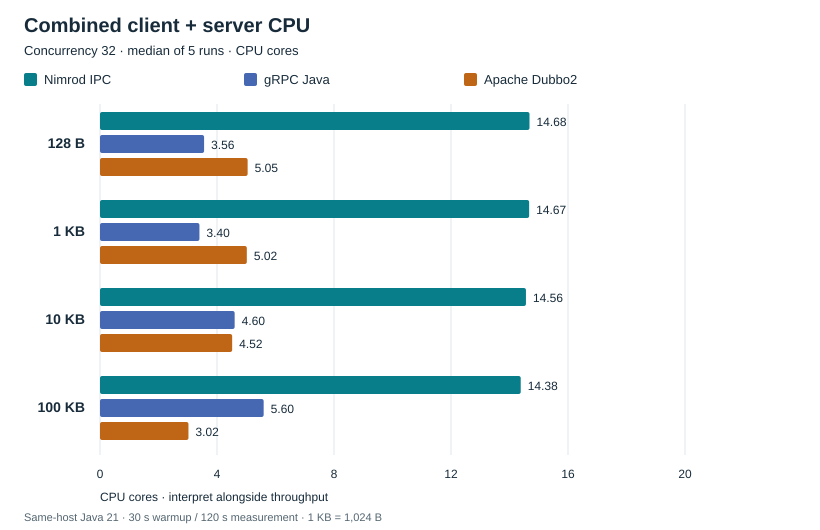

# Nimrod IPC, gRPC Java and Apache Dubbo2: published RPC baseline

**Current release: [Nimrod IPC 4.3.1](https://central.sonatype.com/artifact/io.github.andycrutchlow/nimrod-ipc-rsock/4.3.1).** The samples build against Maven Central artifacts. The published baseline below measures the archived pre-release binary for 4.3.1; it was not rerun for the release. See [binary provenance](#release-and-benchmark-binary-provenance).

This report compares validated, synchronous echo-style RPC calls between separate Java 21 client and server JVMs on one host. It uses only `benchmark-results/published-baseline`, started on 24 October 2026 (UTC): **180 successful runs**, covering three implementations, four payload sizes, three concurrency levels and five repetitions.

Nimrod has higher median throughput than gRPC in all 12 tested configurations, reaching **2.03×** at 128 B / concurrency 32. At concurrency 32 it also exceeds Dubbo2 for 128 B, 1 KB and 10 KB. Dubbo2 leads at 100 KB and at every concurrency-8 payload. These are results for the implementations and environment below, rather than a universal ranking of the frameworks.

[Throughput](#throughput) · [Latency](#latency) · [CPU](#cpu) · [Validation](#validation-and-accounting) · [Reproduction](#reproducing-the-benchmarks)

## Dataset and provenance

The canonical input is the local `benchmark-results/published-baseline` directory. Older runs and scheduler experiments are excluded. Raw measurements and source manifests are unchanged.

- Source revision recorded by the suite: `5540f7ab4fc6b45a1cbc3ee9c736101c2ff47442`.
- [`summary.json`](docs/benchmarks/summary.json) contains the full-precision medians, all five per-configuration observations, classpath artifact hashes, process settings, socket observations and an SHA-256 fingerprint over every canonical archive file.
- [`report.py`](scripts/benchmarks/report.py) verifies the complete matrix, validity/accounting, manifests, artifact consistency, socket counts and CPU reconstruction before generating this report's tables and charts.
- **Archive availability:** `/benchmark-results/` is Git-ignored, and the canonical archive is not tracked in this checkout. The generated summary accompanies these docs, but independent verification against raw histograms, logs and manifests requires obtaining that archive separately. No public archive download location is recorded here. A fresh clone alone cannot regenerate these results.
- `suite.json` retains the runner's generic `performanceConclusions: false` metadata. This report makes qualified comparisons after independently checking the full-duration data; it does not modify that flag.

### Release and benchmark binary provenance

The recorded manifests identify Nimrod as `4.3.1-SNAPSHOT`. Those labels, classpath hashes and source manifests are preserved exactly. The current samples select **4.3.1 from Maven Central**, but that does not relabel the archived measurements as release-binary results.

The released core JAR was downloaded independently from [Maven Central](https://repo.maven.apache.org/maven2/io/github/andycrutchlow/nimrod-ipc-rsock/4.3.1/nimrod-ipc-rsock-4.3.1.jar) on 26 October 2026 and compared with the canonical manifest:

| Core JAR | SHA-256 |
| --- | --- |
| Benchmarked pre-release | `46ea4bafd2c93e615e52b4abbd295a9175c6b90f7518ee00156523ea9a848ad7` |
| Published 4.3.1 | `57281d859c42d7c3fd350ce67148e85eb4c70682ee396659aead03afa0e399b6` |

**The binaries are not identical.** A locally retained pre-release JAR matched the archived hash; comparing its ZIP entries with the Central JAR also found changed class entries, not only packaging metadata. No binary or performance equivalence is claimed. The figures remain the measured pre-release baseline, with no numerical changes. [Release validation](docs/release-validation.md) describes resolution/build checks for the published version; these are not new performance measurements.

## Methodology

### Environment

All 360 client/server manifests report the same environment:

| Item | Recorded value |
| --- | --- |
| Operating system | Mac OS X / macOS 14.5 |
| Architecture | x86_64 |
| Available processors | 16, as reported to the JVM |
| Java vendor | Oracle Corporation |
| Java runtime build | `21.0.8+12-LTS-jvmci-23.1-b72` |
| Heap and collector | `-Xms1g -Xmx1g -XX:+UseG1GC` per JVM |
| Host CPU model / physical core count | Not recorded in the canonical archive |
| Host RAM capacity | Not recorded in the canonical archive |

Do not infer physical hardware from the JVM's available processor count. The archive does not establish host isolation, power settings or background load.

In addition to heap/GC flags, every manifest records:

```text
-XX:ThreadPriorityPolicy=1
-XX:+UnlockExperimentalVMOptions
-XX:+EnableJVMCIProduct
-XX:-UnlockExperimentalVMOptions
```

Dubbo2 client and server additionally use:

```text
--add-opens=java.base/java.lang=ALL-UNNAMED
--add-opens=java.base/java.util=ALL-UNNAMED
--add-opens=java.base/java.text=ALL-UNNAMED
```

These are recorded runtime arguments, including VM-added options. The launcher's explicit application flags and classpaths are in each `launch.json`; `JAVA` selects its Java executable.

### Frameworks and process topology

| Implementation | Version actually benchmarked and encoding | Client connections | Server execution |
| --- | --- | --- | --- |
| Nimrod IPC | `4.3.1-SNAPSHOT`; Kryo 5.5.0; RSocket 1.1.5; Reactor 3.7.8 | Requester pool configured to 1 / 8 / 32 with concurrency; observed 1 / 8 / 32 established TCP sockets | Archived `BenchmarkRmi` uses default `SchedulerType.SINGLE`; generated controller adds no scheduler offload |
| gRPC Java | 1.58.0; Protobuf Java 3.25.3; shaded Netty transport | One shared channel; observed one established TCP socket, multiplexing calls | Explicit eight-thread application executor, queue capacity 32 |
| Apache Dubbo2 | 2.7.23; native Dubbo binary TCP; bundled Kryo SPI, Kryo 4.0.2 / kryo-serializers 0.42 | One reference-private connection, multiplexed; observed one established TCP socket | Eight provider workers, queue capacity 32 |

All applications use Spring Boot 3.5.4. Nimrod and Dubbo2 resolve unshaded Netty 4.1.123.Final. gRPC uses `grpc-netty-shaded` 1.58.0; other dependencies appearing on its classpath do not describe its wire serializer. Client and server manifest artifact hashes are retained in the generated summary.

**Execution metadata discrepancy:** the Nimrod server manifest reports `serverWorkers: 8`, but its recorded contract source hash matches the checked-in interface with no explicit concurrency/scheduler arguments. The generated controller calls `Mono.fromCallable(...)` without `subscribeOn`. The manifest field is a descriptive constant, not evidence of an eight-worker application scheduler. `SINGLE` here does not establish a global single-thread executor across all connections. This benchmark does not equalize application execution or connection management across frameworks.

One server JVM and one client JVM run per case; cases run sequentially. Framework order rotates by repetition. All three use the same local interface, `192.168.40.197`, rather than a remote machine: Dubbo2's loopback URL rewriting motivated the common interface. Established-socket snapshots were captured using `lsof` around measurement start on both processes. They show the connection counts above in all 180 cases; snapshots do not prove the count at every instant.

Dubbo2 uses direct `dubbo://` addressing, no registry (`N/A`), `injvm=false`, `lazy=false`, `retries=0`, and the `failfast` cluster. Its client has a 5,000 ms timeout, 3,000 ms connect timeout, 60,000 ms heartbeat, 180,000 ms heartbeat timeout and 2,000 ms reconnect interval, with TCP_NODELAY and keepalive enabled. Its serializer observations confirm wire serializer ID 8 and positive encode/decode counts on both sides in every run. Benchmark DTOs are not explicitly registered with its serializer.

### Workload and measurement boundaries

The common [`Workload`](benchmark-common/src/main/java/com/nimrodtechs/samples/benchmark/common/Workload.java) constructs deterministic random payload bytes with `java.util.Random`, seed 42. Labels mean **128, 1,024, 10,240 and 102,400 payload bytes**; metadata and serialization framing add wire bytes. The server verifies the request CRC32C, currency pair and tenor, sets a fixed price, and returns the full body with the request identity.

The client checks run ID, phase ID, sequence, currency pair, tenor, price, checksum and byte-for-byte payload equality. Every measured response is validated. There is no compression or TLS configured for these cases. gRPC maps the shared POJO to/from Protobuf; Nimrod and Dubbo2 send the Java DTO using their respective Kryo paths. Serialization and these mappings are part of the comparison.

The load is **closed-loop**: 1, 8 or 32 synchronous client workers each issue their next RPC after the previous one returns and validates. No independent arrival rate is imposed. This measures achieved throughput at bounded concurrency, not overload behavior or latency under a fixed offered load.

Each run performs an application-level readiness RPC, **30 seconds warmup** and **120 seconds measurement**, followed by up to 30 seconds drain. At a phase boundary, calls that finish during drain are counted separately and excluded from measured throughput and the primary latency histogram. Throughput is in-window completions / 120 seconds.

Latency runs from immediately before proxy/stub invocation through response mapping and full validation. It includes connection-pool wait inside the Nimrod proxy; request construction before invocation is outside the latency timer. HDR histograms use three significant digits. No cross-process timestamp subtraction is used for these RPC latencies.

The per-call budget is 5,000 ms. gRPC and Dubbo2 use native client deadlines/timeouts. Nimrod's synchronous proxy has no native bounded client wait; the benchmark monitors and interrupts an over-budget worker and aborts the run. This is not equivalent remote cancellation. See [Nimrod timeout behavior](docs/nimrod-timeouts.md). No such timeout occurred in this baseline.

### Aggregation

Primary values are **medians of five independent repetitions** for each implementation/payload/concurrency combination. The three implementations × 12 configurations × five repetitions produce 180 runs. Tables round only for display; the JSON keeps full precision and per-run throughput ranges.

Each latency cell is the **median of five reported per-run percentiles**. In particular, median p99 is not the p99 of all repetitions' merged observations. Histograms are not pooled across runs. Throughput cells are medians of per-run rates, not an individual run or a rate computed from summed completions.

## Throughput

Completed, validated RPC/s; higher is better. Each chart has a linear zero-based axis; axes are scaled separately for readability. The 100 KB cases remain included.






<!-- generated:throughput:start -->

| Concurrency | Payload | Nimrod RPC/s | gRPC RPC/s | Dubbo2 RPC/s | Nimrod / gRPC |
| --- | --- | --- | --- | --- | --- |
| 1 | 128 B | 13,408 | 9,171 | 11,357 | 1.46× |
| 1 | 1 KB | 12,888 | 9,150 | 11,186 | 1.41× |
| 1 | 10 KB | 11,880 | 8,424 | 10,219 | 1.41× |
| 1 | 100 KB | 4,843 | 4,155 | 5,254 | 1.17× |
| 8 | 128 B | 45,425 | 33,367 | 49,410 | 1.36× |
| 8 | 1 KB | 44,350 | 32,783 | 49,041 | 1.35× |
| 8 | 10 KB | 39,245 | 27,394 | 40,769 | 1.43× |
| 8 | 100 KB | 12,220 | 9,291 | 12,620 | 1.32× |
| 32 | 128 B | 76,449 | 37,675 | 70,503 | 2.03× |
| 32 | 1 KB | 74,263 | 36,624 | 68,854 | 2.03× |
| 32 | 10 KB | 60,939 | 32,820 | 52,597 | 1.86× |
| 32 | 100 KB | 10,962 | 8,092 | 12,441 | 1.35× |

<!-- generated:throughput:end -->

Nimrod/gRPC ratios range from about 1.17× to 2.03×. Nimrod leads Dubbo2 for payloads through 10 KB at concurrency 1 and 32; Dubbo2 leads every concurrency-8 comparison and every 100 KB comparison. Increasing concurrency from 8 to 32 reduces all three implementations' 100 KB throughput in this environment.

## Latency

Milliseconds; lower is better within comparable workloads. This is achieved-load latency in a closed-loop test: each implementation is completing a different number of requests per second.



<!-- generated:latency:start -->

| Concurrency | Payload | Implementation | p50 (ms) | p95 (ms) | p99 (ms) |
| --- | --- | --- | --- | --- | --- |
| 1 | 128 B | Nimrod IPC | 0.072 | 0.094 | 0.121 |
| 1 | 128 B | gRPC Java | 0.110 | 0.130 | 0.153 |
| 1 | 128 B | Apache Dubbo2 | 0.085 | 0.105 | 0.136 |
| 1 | 1 KB | Nimrod IPC | 0.074 | 0.099 | 0.129 |
| 1 | 1 KB | gRPC Java | 0.109 | 0.129 | 0.156 |
| 1 | 1 KB | Apache Dubbo2 | 0.086 | 0.108 | 0.138 |
| 1 | 10 KB | Nimrod IPC | 0.081 | 0.107 | 0.135 |
| 1 | 10 KB | gRPC Java | 0.118 | 0.141 | 0.167 |
| 1 | 10 KB | Apache Dubbo2 | 0.094 | 0.116 | 0.145 |
| 1 | 100 KB | Nimrod IPC | 0.209 | 0.245 | 0.289 |
| 1 | 100 KB | gRPC Java | 0.241 | 0.280 | 0.318 |
| 1 | 100 KB | Apache Dubbo2 | 0.193 | 0.223 | 0.262 |
| 8 | 128 B | Nimrod IPC | 0.173 | 0.218 | 0.241 |
| 8 | 128 B | gRPC Java | 0.236 | 0.292 | 0.323 |
| 8 | 128 B | Apache Dubbo2 | 0.161 | 0.204 | 0.226 |
| 8 | 1 KB | Nimrod IPC | 0.177 | 0.223 | 0.248 |
| 8 | 1 KB | gRPC Java | 0.242 | 0.297 | 0.327 |
| 8 | 1 KB | Apache Dubbo2 | 0.163 | 0.205 | 0.227 |
| 8 | 10 KB | Nimrod IPC | 0.198 | 0.249 | 0.276 |
| 8 | 10 KB | gRPC Java | 0.288 | 0.355 | 0.392 |
| 8 | 10 KB | Apache Dubbo2 | 0.194 | 0.246 | 0.275 |
| 8 | 100 KB | Nimrod IPC | 0.626 | 0.782 | 1.015 |
| 8 | 100 KB | gRPC Java | 0.845 | 1.061 | 1.297 |
| 8 | 100 KB | Apache Dubbo2 | 0.590 | 0.863 | 0.961 |
| 32 | 128 B | Nimrod IPC | 0.382 | 0.699 | 0.945 |
| 32 | 128 B | gRPC Java | 0.846 | 0.982 | 1.031 |
| 32 | 128 B | Apache Dubbo2 | 0.465 | 0.569 | 0.634 |
| 32 | 1 KB | Nimrod IPC | 0.393 | 0.680 | 0.879 |
| 32 | 1 KB | gRPC Java | 0.869 | 1.004 | 1.059 |
| 32 | 1 KB | Apache Dubbo2 | 0.468 | 0.580 | 0.649 |
| 32 | 10 KB | Nimrod IPC | 0.475 | 0.817 | 1.145 |
| 32 | 10 KB | gRPC Java | 0.984 | 1.356 | 1.514 |
| 32 | 10 KB | Apache Dubbo2 | 0.571 | 0.848 | 0.926 |
| 32 | 100 KB | Nimrod IPC | 2.105 | 6.414 | 13.771 |
| 32 | 100 KB | gRPC Java | 3.869 | 4.887 | 6.545 |
| 32 | 100 KB | Apache Dubbo2 | 2.445 | 3.355 | 4.477 |

<!-- generated:latency:end -->

Dubbo2 has lower median p99 than Nimrod in 9 of 12 configurations (all concurrency-8/32 cases and 100 KB at concurrency 1). Nimrod has lower p99 for the three smaller concurrency-1 payloads. At 100 KB / concurrency 32, Nimrod's median p99 is 13.771 ms, versus 6.545 ms for gRPC and 4.477 ms for Dubbo2, despite Nimrod's higher throughput than gRPC. Throughput alone does not establish a latency advantage.

## CPU

CPU is measured in **average cores consumed**: one core means one CPU-second per wall-second (equivalent to 100% of one logical CPU). The JDK process CPU counter is sampled once per second in each JVM's `resources.csv`. Cumulative CPU is linearly interpolated at the common client measurement start/end timestamps, then divided by the 120-second window. This captures the complete process, including transport, serialization, application work, GC and sampling overhead. It excludes the supervisor and other host processes. External `ps` CPU percentages are not used for this chart.

Client/server columns are separate five-run medians. **Combined** is the median of each repetition's client + server cores, so it need not equal the sum of those two displayed medians. The chart uses combined CPU; lower CPU must be interpreted alongside completed RPC/s, rather than as an efficiency ranking at equal work rates.



<!-- generated:cpu:start -->

| Concurrency | Payload | Implementation | Client cores | Server cores | Combined cores |
| --- | --- | --- | --- | --- | --- |
| 1 | 128 B | Nimrod IPC | 0.54 | 0.50 | 1.04 |
| 1 | 128 B | gRPC Java | 0.56 | 0.74 | 1.32 |
| 1 | 128 B | Apache Dubbo2 | 0.54 | 0.52 | 1.06 |
| 1 | 1 KB | Nimrod IPC | 0.53 | 0.50 | 1.03 |
| 1 | 1 KB | gRPC Java | 0.57 | 0.74 | 1.30 |
| 1 | 1 KB | Apache Dubbo2 | — | 0.52 | — |
| 1 | 10 KB | Nimrod IPC | 0.53 | 0.50 | 1.03 |
| 1 | 10 KB | gRPC Java | 0.58 | 0.73 | 1.31 |
| 1 | 10 KB | Apache Dubbo2 | 0.54 | 0.52 | 1.06 |
| 1 | 100 KB | Nimrod IPC | 0.56 | 0.56 | 1.13 |
| 1 | 100 KB | gRPC Java | 0.74 | 0.73 | 1.47 |
| 1 | 100 KB | Apache Dubbo2 | 0.57 | 0.55 | 1.12 |
| 8 | 128 B | Nimrod IPC | 4.32 | 3.10 | 7.41 |
| 8 | 128 B | gRPC Java | — | 2.21 | — |
| 8 | 128 B | Apache Dubbo2 | 1.87 | 1.76 | 3.65 |
| 8 | 1 KB | Nimrod IPC | 4.30 | 3.13 | 7.42 |
| 8 | 1 KB | gRPC Java | 1.69 | 2.22 | 3.91 |
| 8 | 1 KB | Apache Dubbo2 | 1.87 | 1.78 | 3.64 |
| 8 | 10 KB | Nimrod IPC | 4.28 | 3.19 | 7.46 |
| 8 | 10 KB | gRPC Java | 1.76 | 2.23 | 3.98 |
| 8 | 10 KB | Apache Dubbo2 | 1.85 | 1.75 | 3.61 |
| 8 | 100 KB | Nimrod IPC | 4.15 | 3.70 | 7.85 |
| 8 | 100 KB | gRPC Java | 2.02 | 2.16 | 4.18 |
| 8 | 100 KB | Apache Dubbo2 | 1.51 | 1.42 | 2.93 |
| 32 | 128 B | Nimrod IPC | 8.19 | 6.50 | 14.68 |
| 32 | 128 B | gRPC Java | 1.50 | 2.06 | 3.56 |
| 32 | 128 B | Apache Dubbo2 | 2.92 | 2.12 | 5.05 |
| 32 | 1 KB | Nimrod IPC | 8.13 | 6.56 | 14.67 |
| 32 | 1 KB | gRPC Java | 1.41 | 1.98 | 3.40 |
| 32 | 1 KB | Apache Dubbo2 | 2.90 | 2.12 | 5.02 |
| 32 | 10 KB | Nimrod IPC | 7.94 | 6.61 | 14.56 |
| 32 | 10 KB | gRPC Java | 2.00 | 2.60 | 4.60 |
| 32 | 10 KB | Apache Dubbo2 | 2.44 | 2.08 | 4.52 |
| 32 | 100 KB | Nimrod IPC | 7.18 | 7.20 | 14.38 |
| 32 | 100 KB | gRPC Java | 2.84 | 2.76 | 5.60 |
| 32 | 100 KB | Apache Dubbo2 | 1.60 | 1.42 | 3.02 |

<!-- generated:cpu:end -->

`—` means a five-run median is unavailable. The client samples do not bracket the measurement end in `grpc-128B-c8-r1` and `dubbo2-1024B-c1-r1`; both archived CPU summaries are null. Their other metrics remain valid. We do not substitute zero, average only four repetitions or use the differently bounded `clientCpuCoresIncludingDrain` metric. All concurrency-32 CPU comparisons have five complete paired observations.

## Validation and accounting

All **180/180** run results report `valid: true`, `checkPassed: true` and client exit code 0. Readiness, warmup and measurement show **zero recorded errors, timeouts, invalid responses, unresolved calls or histogram recording failures**. All server summaries show zero errors and no resource sampling failures. Server processed counts match client attempts across all phases in every run.

The following counts are **sums across 60 runs per implementation**, not individual-run measurements or median rates. Successful drain completions are ordinary phase-boundary completions, not failures.

<!-- generated:counts:start -->

| Implementation | Phase | Attempted | Completed in window | Completed in drain | Errors | Timeouts | Invalid | Unresolved |
| --- | --- | --- | --- | --- | --- | --- | --- | --- |
| Nimrod IPC | readiness | 60 | 60 | 0 | 0 | 0 | 0 | 0 |
| Nimrod IPC | warmup | 52,973,331 | 52,972,511 | 820 | 0 | 0 | 0 | 0 |
| Nimrod IPC | measurement | 244,313,674 | 244,312,857 | 817 | 0 | 0 | 0 | 0 |
| gRPC Java | readiness | 60 | 60 | 0 | 0 | 0 | 0 | 0 |
| gRPC Java | warmup | 32,581,947 | 32,581,128 | 819 | 0 | 0 | 0 | 0 |
| gRPC Java | measurement | 148,866,363 | 148,865,543 | 820 | 0 | 0 | 0 | 0 |
| Apache Dubbo2 | readiness | 60 | 60 | 0 | 0 | 0 | 0 | 0 |
| Apache Dubbo2 | warmup | 57,527,916 | 57,527,096 | 820 | 0 | 0 | 0 | 0 |
| Apache Dubbo2 | measurement | 235,715,567 | 235,714,747 | 820 | 0 | 0 | 0 | 0 |

<!-- generated:counts:end -->

These checks cover the recorded accounting and manifest consistency. They do not establish delivery guarantees under failures or audit every diagnostic log line for unrelated warnings. The two missing CPU boundary observations above are retained as missing data rather than reclassified as RPC failures.

## Limitations and interpretation

- Same-host traffic shares CPU and memory bandwidth. These measurements do not characterize a real network, TLS, WAN behavior, different hosts/JVMs or production-sized application logic.
- Connection counts, serializers, DTO mappings and server execution differ. Multiple Nimrod requester connections at concurrency 8/32 are part of the tested configuration; this is not an equal-connection transport microbenchmark.
- The 100 KB results and p99/CPU tradeoffs matter. None of these results proves universal superiority across throughput, latency, CPU, resource use or developer requirements.
- A closed-loop generator reduces offered traffic when calls slow down. Its latency distribution does not quantify queuing under a constant external arrival rate. Five-run medians are descriptive; no confidence intervals or statistical-significance claim is made.
- This report measures unary request/response only. It makes no comparative performance claim for pub/sub, wildcard routing, conflation, fire-and-forget, durability or failure recovery.
- CPU model and RAM were not captured, the archive is not currently tracked, and the Nimrod worker metadata differs from its generated execution path. These constrain independent reproduction and must accompany the numbers.
- Nimrod was a snapshot build. Artifact SHA-256 values identify the measured jars; a later jar with the same snapshot version can behave differently. Source hashes in `source-manifest.json` describe the samples, not a complete independent library-source/build provenance record.

## Reproducing the benchmarks

Requirements: Java 21 or later, Maven and Python 3. The samples now resolve Nimrod **4.3.1 directly from Maven Central**; no local library installation is required. The recorded performance environment remains Java 21; Java 25 compatibility checks are documented separately in [release validation](docs/release-validation.md). See [building the samples](README.md#build-once). Cache dependencies before using offline mode. `lsof` is needed to repeat the established-socket observations; the runner also invokes `ps` for OS resource samples. The process supervisor uses POSIX process groups; Linux/macOS are the intended environments, not native Windows.

Full benchmark command (macOS):

```bash
caffeinate -i python3 scripts/benchmarks/run.py \
  --full \
  --offline \
  --output benchmark-results/published-baseline
```

`caffeinate` prevents idle sleep on macOS. Without that macOS utility, use the same runner directly:

```bash
python3 scripts/benchmarks/run.py \
  --full \
  --offline \
  --output benchmark-results/published-baseline
```

These commands describe creation of a baseline in a **new, empty destination**, using the current published 4.3.1 dependency. They cannot recreate the archived pre-release binary or establish release performance equivalence. Do not run them over the existing canonical archive: run directories refuse overwrite, but suite-level files are written first. For another measurement use a distinct destination, such as `benchmark-results/reproduction-2026-10-25`. Unfiltered full runs require at least 7.5 hours of timed phases plus startup/readiness/drain. Cases never compete with another benchmark case.

Short correctness checks (these are not performance evidence):

```bash
python3 scripts/benchmarks/run.py --smoke --offline
python3 scripts/benchmarks/run.py --integration --offline
```

Default/`--smoke` selects all 36 combinations, one repetition, 0.3-second warmup / 0.7-second measurement. `--integration` adds one intentional delayed-handler timeout check per implementation. Smoke and integration do not execute the full suite.

Targeted checks and full-duration measurements:

```bash
python3 scripts/benchmarks/run.py --smoke --offline \
  --implementations nimrod grpc --sizes 128 102400 --concurrency 1 32

python3 scripts/benchmarks/run.py --full --offline \
  --implementations nimrod --sizes 1024 --concurrency 8 32 \
  --output benchmark-results/targeted-reproduction
```

The second command selects ten full-duration runs. All current runner options are:

| Option | Behavior |
| --- | --- |
| `--full` / `--smoke` / `--integration` | Mutually exclusive modes; smoke is default |
| `--implementations nimrod grpc dubbo2` | One or more targets; all by default |
| `--sizes 128 1024 10240 102400` | One or more payload byte counts; all by default |
| `--concurrency 1 8 32` | One or more worker counts; all by default |
| `--host ADDRESS` | Local bind/target interface; otherwise auto-detect when Dubbo2 is selected |
| `--offline` | Pass `-o` to the Maven build; dependencies must already be cached |
| `--skip-build` | Reuse compiled classes and `target/benchmark-classpath.txt`; build first |
| `--output PATH` | Destination; otherwise a UTC timestamp under `benchmark-results/` |
| `-h`, `--help` | Show current CLI help |

Build/classpath preparation and runner tests without running benchmark cases:

```bash
mvn verify dependency:build-classpath -Dmdep.outputFile=target/benchmark-classpath.txt
python3 -m unittest discover -s scripts/benchmarks/tests -v
```

Regenerate this report's tables, chart data and all five SVGs from the existing canonical archive, without running benchmarks:

```bash
python3 scripts/benchmarks/report.py
python3 scripts/benchmarks/report.py --check
```

To also refresh the library's chart copy, add `--library-docs ../nimrod-ipc-rsock-parent`. The generator uses only the Python standard library, writes no benchmark inputs, rejects missing/failed/duplicate runs, and preserves missing CPU values. The chart SVGs embed their own labels and accessible descriptions and need no external assets or JavaScript.

Further implementation details: [runner mechanics](docs/benchmark-running.md), [programming models](docs/developer-experience.md), [timeout behavior](docs/nimrod-timeouts.md). Historical planning/validation documents are retained for development context; **this report is the published performance reference**.
