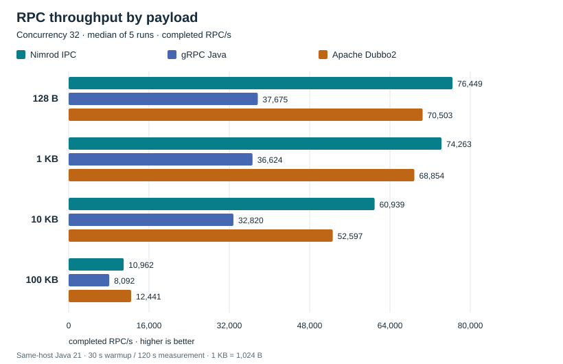

# Nimrod IPC samples

Runnable examples for [Nimrod IPC 4.3.1](https://github.com/andycrutchlow/nimrod-ipc-rsock-parent): annotation-driven synchronous RPC, fire-and-forget calls and direct publish/subscribe with wildcard subjects. This repository also contains gRPC Java and native Apache Dubbo2 implementations of a shared, validated echo-style RPC benchmark.

[Run RPC](#basic-nimrod-rpc) · [Run pub/sub](#publishsubscribe-and-wildcards) · [Sample map](#sample-map) · [Benchmark report](BENCHMARKS.md)

## Build once

**Java compatibility:** Requires Java 21 or later. Tested with Java 21 and Java 25; the compiler and bytecode target remain Java 21. See [release validation](docs/release-validation.md) for the checks and tested JDK builds.

Use Maven and a POSIX shell (macOS/Linux). The examples use Spring Boot 3.5.4 and **Nimrod IPC 4.3.1**, resolved directly from [Maven Central](https://central.sonatype.com/artifact/io.github.andycrutchlow/nimrod-ipc-rsock/4.3.1).

```bash
git clone https://github.com/andycrutchlow/nimrod-ipc-rsock-samples.git
cd nimrod-ipc-rsock-samples
mvn verify dependency:build-classpath -Dmdep.outputFile=target/benchmark-classpath.txt
```

The root POM selects `4.3.1` through the shared `nimrod.ipc.version` property for the runtime, annotations, processor and parent POM. Maven downloads these from Central; building or installing the library source is unnecessary. For an application dependency:

```xml
<dependency>
  <groupId>io.github.andycrutchlow</groupId>
  <artifactId>nimrod-ipc-rsock</artifactId>
  <version>4.3.1</version>
</dependency>
```

The Maven build compiles and tests all modules and generates each runnable module's classpath file. It does **not** run benchmarks. Add `-o` after dependencies are cached. Commands below run from the samples repository root in separate terminals. They use `java -cp` because the modules are ordinary jars, without an executable Boot jar packaging configuration. `:` is the POSIX classpath separator.

To build just a sample pair and its dependencies:

```bash
mvn -pl nrpc-server-basic,nrpc-client-basic -am verify \
  dependency:build-classpath -Dmdep.outputFile=target/benchmark-classpath.txt
```

Substitute the relevant pair from the module table below. The same reactor build pattern applies to every pair.

## Sample map

| Modules | Demonstrates | Entry points / expected result |
| --- | --- | --- |
| [`nrpc-common`](nrpc-common) | Shared pricing interface, DTOs and annotation processing; benchmark contract | Contract module; no standalone server/client |
| [`nrpc-server-basic`](nrpc-server-basic), [`nrpc-client-basic`](nrpc-client-basic) | Synchronous pricing RPC, parallel callers, fire-and-forget | `ServerBasicApplication`, `ClientBasicApplication`; HTTP-triggered price responses and send statistics |
| [`pubsub-publisher-basic`](pubsub-publisher-basic), [`pubsub-subscriber-basic`](pubsub-subscriber-basic) | Subject publishing, exact and wildcard subscriptions | `PublisherBasicApplication`, `SubscriberBasicApplication`; interactive menu and `RECEIVED` messages |
| [`pubsub-loadtest-publisher`](pubsub-loadtest-publisher), [`pubsub-loadtest-subscriber`](pubsub-loadtest-subscriber) | Configurable subjects, payloads and publish rate; subscriber diagnostics | `PublisherCliApp`, `SubscriberCliApp`; per-second rate/latency/gap logs |
| [`grpc-common`](grpc-common), [`grpc-server-basic`](grpc-server-basic), [`grpc-client-basic`](grpc-client-basic) | Protobuf pricing service and comparative unary RPC | `GrpcServerApplication`, `GrpcClientApplication`; HTTP pricing example or finite benchmark profile |
| [`dubbo-common`](dubbo-common), [`dubbo-server-basic`](dubbo-server-basic), [`dubbo-client-basic`](dubbo-client-basic) | Java interface RPC over native Dubbo2 TCP, without a registry | `DubboServerApplication`, `DubboClientApplication`; benchmark-profile server/client only |
| [`benchmark-common`](benchmark-common) | Shared request validation, processing, bounded client loop, histograms and resources | Support module; no standalone application |

All application classes above are under `src/main/java`. Exact fully qualified names and launch commands follow.

## Basic Nimrod RPC

Start the server:

```bash
java -cp "nrpc-server-basic/target/classes:$(cat nrpc-server-basic/target/benchmark-classpath.txt)" \
  com.nimrodtechs.samples.ServerBasicApplication \
  --server.port=8080
```

Start the client in a second terminal:

```bash
java -cp "nrpc-client-basic/target/classes:$(cat nrpc-client-basic/target/benchmark-classpath.txt)" \
  com.nimrodtechs.samples.ClientBasicApplication
```

The server listens for Nimrod RPC on **40280**; its HTTP port is explicitly set to **8080** above (the YAML default is a random port). The client serves HTTP on **8081** and connects to logical service `server1`. Its extra configured `server2` endpoint is not used by these calls. The server YAML also sets `spring.rsocket.server.port: 0`; that requests an ephemeral Spring RSocket port, **not** disabling its auto-configuration. The Nimrod listener is configured separately.

Invoke the examples:

```bash
curl 'http://localhost:8081/price?ccyPair=EUR%2FUSD&tenor=SPOT'
curl 'http://localhost:8081/parallel-price?ccyPair=EUR%2FUSD&tenor=SPOT&threads=4'
```

The first returns a JSON `PriceResponse` with `ccyPair: "EUR/USD"`, `tenor: "SPOT"`, `price: "1.1234"` and timing fields. The second returns four response objects and the requested parallelism. Both endpoints make 5,000 warmup calls before their demonstration calls; they are convenience examples, not the published benchmark workload.

The [shared contract](nrpc-common/src/main/java/com/nimrodtechs/samples/rmiservices/pricing/PricingServiceRmiInterface.java) is:

```java
@NimrodRmiInterface(serviceName = "server1", concurrency = 8, scheduler = SchedulerType.PARALLEL)
public interface PricingServiceRmiInterface {
    PriceResponse getPrice(PriceRequest request) throws Exception;

    @NimrodFireAndForget
    void publishPriceUpdate(PriceUpdateEvent event) throws Exception;
}
```

The imports and DTOs are in the linked source. [`nrpc-common/pom.xml`](nrpc-common/pom.xml) configures `io.github.andycrutchlow:nimrod-ipc-rsock-processor` on `annotationProcessorPaths`. It generates a Spring client and controller in the interface's package. The [server implementation](nrpc-server-basic/src/main/java/com/nimrodtechs/samples/PricingService.java) implements the Java interface; the [client controller](nrpc-client-basic/src/main/java/com/nimrodtechs/samples/ClientBasicController.java) injects it and makes ordinary synchronous calls.

Server scanning includes `com.nimrodtechs.ipcrsock.server` and the contract package; client scanning includes `com.nimrodtechs.ipcrsock.client` and that package. Both applications scan Nimrod configuration properties. The actual client configuration key is `nimrod.rsock.client-side.server1`, with `host`, `port` and `maxConcurrentCalls: 8`. That setting limits borrowed requesters and configures pool capacity; it is separate from the interface's server scheduler configuration.

`PARALLEL` uses a generated Reactor scheduler with the specified thread count. Calls still block their client thread until a response arrives. The default `SINGLE` setting adds no scheduler offload; it should not be described as a global serial executor across all network connections. `timeoutMs` is server-side only, and the current retry-policy annotation is a placeholder. See the [library README](https://github.com/andycrutchlow/nimrod-ipc-rsock-parent#rpc-programming-model).

### Fire-and-forget

With the same server/client pair running:

```bash
curl 'http://localhost:8081/burst?messages=100&threads=1&payloadBytes=128'
curl 'http://localhost:8080/fnf/server-metrics'
```

`/burst` calls `publishPriceUpdate`, returning client send counts, detected errors and send-duration statistics. The initial connectivity call adds one extra event. Poll the server metrics to observe processing; they are cumulative until restart. A successful send does not acknowledge server execution. The client waits for RSocket's send operation, and server fire-and-forget handlers run on virtual threads. This sample is separate from the request/response baseline in `BENCHMARKS.md`.

## Publish/subscribe and wildcards

Stop the load-test publisher if it is already using 40281. Start the basic publisher:

```bash
java -cp "pubsub-publisher-basic/target/classes:$(cat pubsub-publisher-basic/target/benchmark-classpath.txt)" \
  com.nimrodtechs.samples.PublisherBasicApplication
```

Start the subscriber in an interactive terminal:

```bash
java -cp "pubsub-subscriber-basic/target/classes:$(cat pubsub-subscriber-basic/target/benchmark-classpath.txt)" \
  com.nimrodtechs.samples.SubscriberBasicApplication \
  --spring.application.name=prices-subscriber
```

The application name is required by the configured subscriber setup; it is absent from the checked-in YAML. The subscriber connects to `publisher1,localhost,40281`.

Choose `1` for `EURUSD.*`, `2` for `EURUSD.SPOT` or `3` for `EURUSD.1W`; `q` exits. The publisher alternates spot and one-week `MarketData` updates one second apart. Expect `RECEIVED -> EURUSD.SPOT` and/or `RECEIVED -> EURUSD.1W` logs according to your selection, and subscription notifications on the publisher.

Selections add subscriptions; they do not replace earlier selections. Repeating a selection with the same listener is ignored. The library shares overlapping upstream subscriptions and avoids notifying the same listener twice for an overlapping exact/wildcard match. `EURUSD.*` is a trailing prefix wildcard and can cover deeper subjects as well as one suffix segment.

The core calls, taken from these applications, are:

```java
publisherSocket.publish(msg.ccyPair() + "." + msg.tenor(), msg);
subscriberService.subscribe("publisher1", "EURUSD.*", receiver, MarketData.class, false);
```

### Conflation, subscription lifecycle and reconnection

Both runnable subscriber applications use **`conflate=false`**. There is currently no standalone conflation demo or CLI switch. The library supports passing `true` to the same `subscribe` API; its [README](https://github.com/andycrutchlow/nimrod-ipc-rsock-parent#publishsubscribe) provides a compilable example. Conflation replaces older pending updates when a listener falls behind, useful when the latest price or state matters more than intermediate updates. A wildcard subscription shares one conflation queue across its matched subjects; subscribe to exact subjects for independent queues.

The library provides `unsubscribe(publisherName, subject, listener)`, but the menu does not expose unsubscribe. Keep the listener instance to remove it programmatically.

You can exercise the basic subscriber's automatic reconnect/subscription recovery by stopping and restarting the publisher while leaving the subscriber running. Wait for transport failure detection and recovery; the keepalive settings can make detection slow after a silent outage. Newly published matching messages should resume after reconnection. There is no separate fault-injection or connection-management sample and no replay of messages missed during disconnection.

Pub/sub is live, in-memory distribution. FIFO listener queues and transport backpressure handling can drop updates under overload; `conflate=false` does not establish lossless delivery, persistent queues or durable subscriptions.

## Pub/sub load-test tools

These are configurable demonstration tools, separate from the published RPC comparison. Build the two `pubsub-loadtest-*` modules with the reactor command above. Stop the basic publisher before starting this pair.

Start the load publisher:

```bash
java -Dnimrod.rsock.publisher.port=-1 \
  -cp "pubsub-loadtest-publisher/target/classes:$(cat pubsub-loadtest-publisher/target/benchmark-classpath.txt)" \
  com.nimrodtechs.samples.PublisherCliApp \
  --publisher publisher1 --port 40281 --subjects EURUSD.SPOT,EURUSD.1W \
  --rate 1000 --payload-size 128 --duration-seconds 60 --mode round-robin
```

The JVM property suppresses the library's automatic publisher bind because this CLI explicitly calls `start(port)` itself; otherwise its YAML and CLI both try to bind the same port. All `--option value` arguments shown are parsed by the application, so use JVM `-D` properties for Spring settings.

Start its subscriber:

```bash
java -Dspring.application.name=load-subscriber \
  -cp "pubsub-loadtest-subscriber/target/classes:$(cat pubsub-loadtest-subscriber/target/benchmark-classpath.txt)" \
  com.nimrodtechs.samples.SubscriberCliApp \
  --publisher publisher1 --subjects 'EURUSD.*'
```

Expect per-second logs of `rate`, `total`, `avgLatency`, `maxLatency` and `gaps`. The publisher stops producing after 60 seconds, but its JVM and the subscriber remain running; use Ctrl-C to stop each. Starting the subscriber later misses earlier updates. Gap counts track sequence discontinuities, which can also reflect subject filtering or dispatch order, so they are not a delivery guarantee. The tools subtract `System.nanoTime()` values from different JVMs for diagnostic latency; these are not portable cross-host measurements or the RPC latency method used in `BENCHMARKS.md`.

Publisher options: required `--subjects`; optional `--publisher`, `--port`, `--rate`, `--payload-size`, `--duration-seconds`, and `--mode fixed|round-robin`. Defaults are `samplePublisher`, 40281, 1000 messages/s, 128 B, 30 seconds and `fixed`. Fixed mode uses only the first subject. Subscriber options are required `--publisher` and `--subjects`. The subscriber publisher alias must match its YAML setup (`publisher1` here).

## gRPC pricing example

Build `grpc-server-basic,grpc-client-basic` and dependencies, or use the complete build above. Start its server:

```bash
java -cp "grpc-server-basic/target/classes:$(cat grpc-server-basic/target/benchmark-classpath.txt)" \
  com.nimrodtechs.samples.grpcserver.GrpcServerApplication \
  --server.port=8082
```

Start its client:

```bash
java -cp "grpc-client-basic/target/classes:$(cat grpc-client-basic/target/benchmark-classpath.txt)" \
  com.nimrodtechs.samples.grpcclient.GrpcClientApplication \
  --server.port=8083
```

The client connects to plaintext gRPC port 9090. Invoke:

```bash
curl 'http://localhost:8083/grpc/price?ccyPair=EUR%2FUSD&tenor=SPOT'
curl 'http://localhost:8083/grpc/parallel-price?ccyPair=EUR%2FUSD&tenor=SPOT&threads=4'
```

Expect price `"1.2345"` and timing fields, or four responses. This legacy pricing constant differs from Nimrod's demo constant. The comparative **benchmark profile** instead runs the identical common echo-style workload and price `"1.1234"` in all three frameworks.

To validate both original pricing examples automatically after building (starts/stops its own server/client processes on free ports):

```bash
python3 scripts/benchmarks/check_examples.py
```

## Comparative RPC implementations

The benchmark profile reuses the Nimrod and gRPC main applications and adds a native Dubbo2 provider/consumer pair. [`benchmark-common`](benchmark-common) supplies deterministic payload construction, identical server processing, full-response validation, closed-loop concurrency, histograms and process sampling. Nimrod uses a generated Java-interface proxy and Kryo 5; gRPC uses a generated blocking Protobuf stub with mappings; Dubbo2 uses Java-interface proxies, its binary TCP protocol and bundled Kryo 4 SPI. Dubbo2 uses direct addressing, no registry and no in-JVM shortcut.

Use the runner for the Dubbo2 modules' build, server and client startup:

```bash
python3 scripts/benchmarks/run.py --smoke --offline \
  --implementations dubbo2 --sizes 128 --concurrency 1
```

It builds the reactor, starts the server, waits for readiness, starts the finite client, records a validated summary, then stops the server. Expect `dubbo2-128B-c1-r1: PASS` and `1/1 checks passed`. There is no standalone Dubbo2 pricing HTTP endpoint. The same runner supports `--implementations nimrod` or `grpc` for their comparative profile. Use a new output directory for each invocation.

### Published performance

**Up to approximately 2× gRPC Java's RPC throughput in the tested same-host Java 21 configurations.** Nimrod leads gRPC throughput in all 12 configurations. At concurrency 32, it also leads Dubbo2 through 10 KB; Dubbo2 leads at 100 KB and generally has lower p99 latency.



Medians of five runs; 30-second warmup / 120-second measurement; separate client/server JVMs. Nimrod requester pools use 1/8/32 connections, while gRPC and Dubbo2 each use one multiplexed connection. This is a closed-loop comparison with differing connection and server execution models. Higher throughput does not imply lower latency or CPU use.

See **[BENCHMARKS.md](BENCHMARKS.md)** for all 12 configurations, p50/p95/p99, CPU, framework/JVM versions, validation counts, limitations and reproduction commands. Its tables and five SVGs are generated exclusively from the canonical `published-baseline` archive; the report distinguishes the measured binary from the current 4.3.1 release. That raw directory is currently Git-ignored; the report records the resulting public reproducibility gap.

Regenerate charts and check them without running benchmarks:

```bash
python3 scripts/benchmarks/report.py
python3 scripts/benchmarks/report.py --check
```

The [benchmark report](BENCHMARKS.md#reproducing-the-benchmarks) documents smoke, integration, targeted and full-duration commands and every supported runner option. [Implementation notes](docs/developer-experience.md) and [Nimrod timeout behavior](docs/nimrod-timeouts.md) provide additional context. Existing development and investigation documents remain under [`docs/`](docs).

## License and contributions

Nimrod IPC is published under the [Apache License 2.0](https://central.sonatype.com/artifact/io.github.andycrutchlow/nimrod-ipc-rsock). Preserve source copyright and license notices when reusing code. Neither this samples checkout nor the library checkout currently includes a root `LICENSE` file; consult the relevant artifact metadata and source notices. Issues and pull requests belong in the corresponding GitHub repository.
